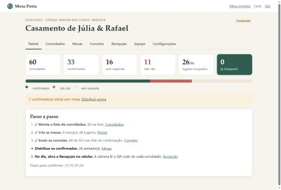
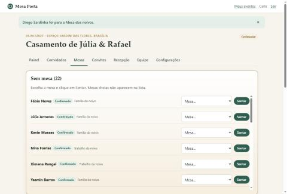
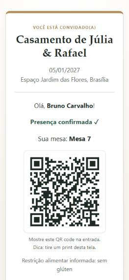
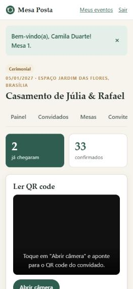
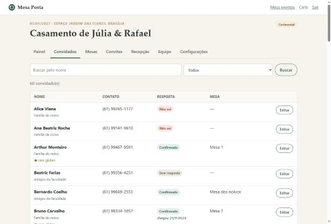

# Mesa Posta · aplicativo completo

Sistema para **cerimonial de casamentos**: lista de convidados, **confirmação de presença por link no
celular**, **mesas com capacidade garantida** e **check-in por QR code** na entrada da festa.

> **Duas versões do mesmo projeto:**
>
> | Repositório | O que é |
> |---|---|
> | **mesa-posta-app** (este) | **Produto finalizado**: telas para cerimonial, noivos, convidados e recepção, prontas para usar |
> | [mesa-posta-api](https://github.com/leoesquivelcouto/mesa-posta-api) | **Amostra de código**: só o backend (API REST documentada), com o foco nas regras de negócio e nos testes |
>
> Este repositório nasceu de uma cópia do mesa-posta-api (o histórico de commits foi mantido) e acrescenta a
> interface. As regras de negócio são as mesmas e continuam acessíveis como API em `/api`.

<p align="center">
  
  
</p>
<p align="center">
  
  
  
</p>

## Para quem é e o que cada um faz

| Quem | Onde | O que faz |
|---|---|---|
| **Cerimonial** | computador ou celular | Cria o evento, importa a planilha de convidados, cria as mesas, gera os links de confirmação (com botão de WhatsApp), monta a equipe |
| **Noivos** | computador ou celular | Editam a lista de convidados e distribuem as mesas |
| **Convidado** | celular, **sem conta** | Abre o link, confirma ou recusa, informa restrição alimentar e recebe o QR code de entrada e a mesa |
| **Recepção** | celular, no dia | Lê o QR code com a câmera (ou busca pelo nome) e vê na hora a mesa da pessoa e qualquer alerta |

### Um evento do começo ao fim

1. O cerimonial cria a conta e o evento (data, local e prazo para confirmar).
2. **Convidados:** importa a planilha do Excel ou do Google Planilhas (CSV). Se alguma linha tiver erro,
   nada é gravado e o aviso diz qual linha corrigir; quem já estava na lista é ignorado.
3. **Mesas:** cria todas de uma vez ("8 mesas de 10 lugares").
4. **Convites:** gera um link único por convidado e envia pelo botão de WhatsApp (mensagem pronta) ou baixa a
   planilha com todos os links.
5. **O convidado confirma** pelo celular. Quem recusa sai da mesa automaticamente. Depois do prazo, o link
   não aceita mais respostas.
6. **Mesas:** os confirmados sem mesa aparecem no topo; escolhe a mesa e clica em Sentar. Mesas cheias nem
   aparecem na lista, e o servidor recusa se duas pessoas tentarem o último lugar ao mesmo tempo.
7. **No dia:** a recepção abre a aba Recepção no celular, toca em "Abrir câmera" e aponta para o QR code do
   convidado. Aparece "Bem-vindo(a), Ana! Mesa 7", ou um alerta se a pessoa não tinha confirmado, está sem
   mesa ou já entrou.
8. **Painel:** confirmados, sem resposta, recusados, lugares ocupados e quantos já chegaram, em tempo real.

## Como rodar

### Com Docker

```bash
cp .env.example .env    # preencha SEGREDO_JWT
docker compose up --build
```

Aplicativo em http://localhost:8000. As migrações rodam ao subir.

### Sem Docker

Requer Python 3.12+ e PostgreSQL 15+.

```bash
python -m venv .venv && .venv\Scripts\activate      # Linux/macOS: source .venv/bin/activate
pip install -e ".[dev]"
cp .env.example .env                                  # ajuste DATABASE_URL, SEGREDO_JWT e URL_PUBLICA
python scripts/criar_banco.py && alembic upgrade head
uvicorn mesa.app:app --reload --no-access-log
```

### Dados de demonstração

```bash
python scripts/demo.py
```

Cria um casamento fictício com 60 convidados (nomes inventados), 8 mesas, respostas variadas e duas contas:
`cerimonial@demo.local` e `recepcao@demo.local`, senha `mesaposta-demo`. Os links de alguns convidados vão para
`logs/demo-links.txt`. **Só para uso local.**

## Como foi feito

**Telas renderizadas no servidor** (FastAPI + Jinja2), sem React e sem etapa de build:

- um único serviço para publicar, sem API pública separada para proteger;
- páginas leves, que abrem rápido no celular do convidado, até com internet ruim;
- todas as telas funcionam **sem JavaScript**; o JS só melhora (copiar link, confirmar exclusão, baixar a
  planilha, ler o QR);
- o leitor de QR usa a biblioteca **jsQR servida pelo próprio app**: na festa, não depende de CDN.

**Mesmas regras da API.** As telas chamam os mesmos serviços (`mesa/servicos.py`) que a API, então valem as
mesmas garantias: capacidade da mesa com `SELECT ... FOR UPDATE`, chave estrangeira composta (mesa do mesmo
evento), check-in atômico (`UPDATE ... WHERE checkin_em IS NULL`) e importação tudo-ou-nada. O detalhe de cada
uma está no README do [mesa-posta-api](https://github.com/leoesquivelcouto/mesa-posta-api).

### Segurança

| Risco | Proteção |
|---|---|
| Roubo de sessão por script | Sessão em cookie **HttpOnly** + **SameSite=Lax** (+ **Secure** em HTTPS), assinada (JWT, 12 h) |
| Formulário enviado por outro site (CSRF) | Token **double-submit** em todo POST; sem ele, 403 |
| Redirecionamento para site malicioso após o login | Só aceita caminhos internos (`/...`); testes com `https://`, `//` e `/\` |
| Vazamento do link do convidado | Token de 256 bits; banco guarda **só o hash**; páginas com `no-store` e `Referrer-Policy: no-referrer`; token mascarado nos logs |
| Acesso a evento alheio | Cada página confere o papel da pessoa no evento; quem não participa recebe 404 |
| Clickjacking e afins | `X-Frame-Options: DENY`, `X-Content-Type-Options: nosniff`, câmera liberada só para o próprio site |
| Descobrir quais e-mails têm conta | Login leva o mesmo tempo com e-mail inexistente ou senha errada |

## Testes

```bash
pytest --cov      # 67 testes, cobertura de 92% (precisa de TEST_DATABASE_URL)
ruff check .
```

- **57 testes da API** (herdados do mesa-posta-api): regras de negócio, concorrência e migrações, contra
  PostgreSQL de verdade.
- **10 testes das telas**, incluindo o fluxo inteiro como uma pessoa usaria (cadastro → evento → planilha →
  mesas → convites → o convidado confirma no celular → mesa → check-in pelo QR, repetido e inválido) e as
  proteções: CSRF, cookie protegido, redirecionamento externo, papéis e quem não participa do evento.

Verificado também no navegador, em tamanho de computador e de celular, com os dados de demonstração.

## Limitações e próximos passos

- [ ] Publicar online (o app está pronto para um serviço com PostgreSQL gerenciado; falta escolher e configurar).
- [ ] Validar com um cerimonial de verdade num evento e registrar o resultado aqui.
- [ ] Recuperação de senha e convite da equipe por e-mail (hoje a pessoa cria a conta e o cerimonial a adiciona).
- [ ] Acompanhantes ("+1") por convite e exportação da lista final por mesa (para o buffet).
- [ ] Limite de tentativas de login por IP.
- [ ] Anonimizar os dados dos convidados alguns dias depois do evento (LGPD).

## Licença

MIT.

## Como foi construído

Desenvolvido com auxílio de um assistente de IA (Claude) para acelerar a implementação. As regras de negócio
vêm da minha experiência trabalhando com cerimonial.
